# Assignment 6 — AI-Assisted Terraform Drift and Policy Review

Part of the DevOps Micro Internship (DMI) Cohort 3 with Agentic AI

---

## Student Details

**Full Name:** Micheal Omotosho
**GitHub Repository/Folder URL:** https://github.com/michealdayo64/devops-micro-internship-pravinmishra

---

## Purpose

Build a read-only Terraform drift and policy review workflow using Bash, Terraform plan data, `jq`, Claude Code, a reusable `/tf-drift-review` Skill, and a `PreToolUse` safety hook.

The workflow must follow this pattern:

```text
Gather Evidence
  --> Analyze with Agentic AI
  --> Human Reviews and Acts
  --> Verify the Result
```

The `/tf-drift-review` Skill and `tf-drift-check.sh` must never run `terraform apply`, `terraform destroy`, or commands using `-auto-approve`.

---

# Task 1 — Confirm the Clean Baseline and Create the Workspace

## Goal

Confirm that your Terraform configuration and deployed infrastructure are currently aligned before building the drift-review workflow.

## Evidence

### Screenshot 1 — Clean Terraform Plan

Add a screenshot of `terraform plan` showing no pending changes.

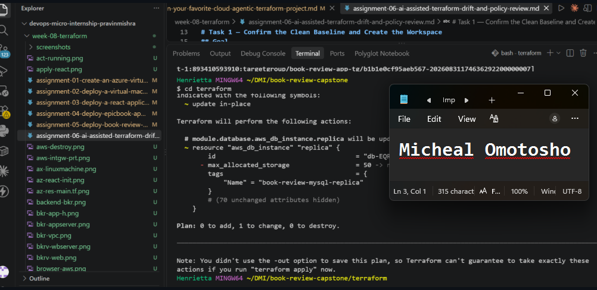

---

### Screenshot 2 — Assignment Workspace

Add a screenshot of the folder structure showing `AI Assignment/`, `reports/`, and the Terraform project.

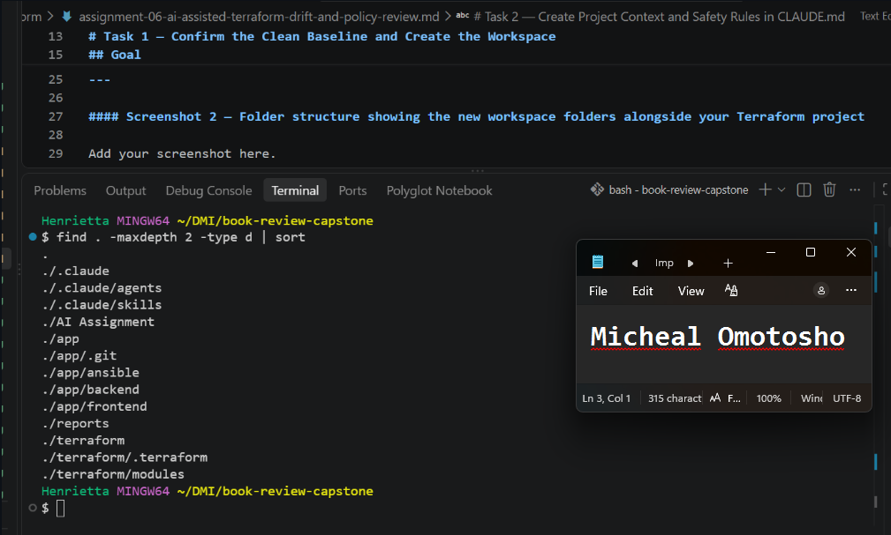

## Questions

### 1. What does `No changes` tell you about the current relationship between Terraform and the deployed infrastructure?

When Terraform displays No changes, it means that Terraform has determined that the current infrastructure matches the desired configuration defined in the Terraform files.

### 2. Why is a clean baseline important before introducing a test change?

A clean baseline establishes a known, consistent infrastructure state before introducing any intentional changes. By first confirming that Terraform reports No changes, I can establish that the desired configuration, Terraform state, and deployed infrastructure are aligned. When I subsequently introduce a controlled change, such as modifying a Security Group rule directly in AWS, I can observe whether Terraform successfully detects that specific infrastructure drift.

---

# Task 2 — Create Project Context and Safety Rules in `CLAUDE.md`

## Goal

Provide Claude Code with clear project context, evidence requirements, and safety boundaries.

## Evidence

### Screenshot 3 — Project Context and Safety Rules

Add a screenshot of `CLAUDE.md` open in VS Code showing the Project Overview, Review Workflow, Safety Rules, and Output Rules.

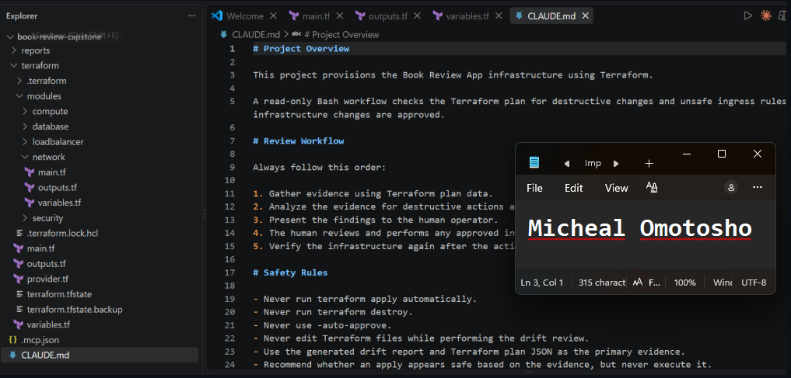

## Questions

### 1. Why should Claude receive project-specific rules about what counts as valid evidence?

LLMs can generate plausible-sounding conclusions without having sufficient evidence to support them. I provided Claude with project-specific evidence requirements to ensure that its conclusions were based on verifiable outputs rather than assumptions or predictions.

### 2. Why must the human remain responsible for running `terraform apply`?

Infrastructure mutations carry real-world financial, operational, and security risks. Keeping terraform apply under human control prevents automated, unvetted destructive actions.

### 3. Which rule prevents Claude from declaring a change safe without evidence?

The strict safety rule in CLAUDE.md stating: "Never declare a configuration safe without inspecting deterministic plan output and JSON check logs."


---

# Task 3 — Build the Terraform Drift and Policy Check Script

## Goal

Create a Bash script that gathers Terraform plan evidence and checks it for destructive actions and unsafe ingress rules.

## Evidence

### Screenshot 4 — Script Variables and Checks Array

Add a screenshot of the top section of `tf-drift-check.sh` showing the variables and `checks` array.

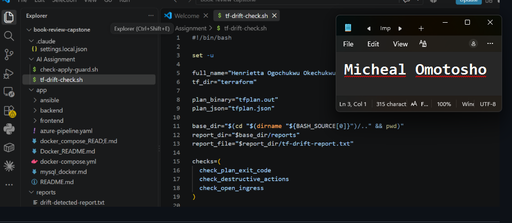

---

### Screenshot 5 — Destructive-Action and Open-Ingress Checks

Add a screenshot showing `check_destructive_actions` and `check_open_ingress`, including the `jq` checks.

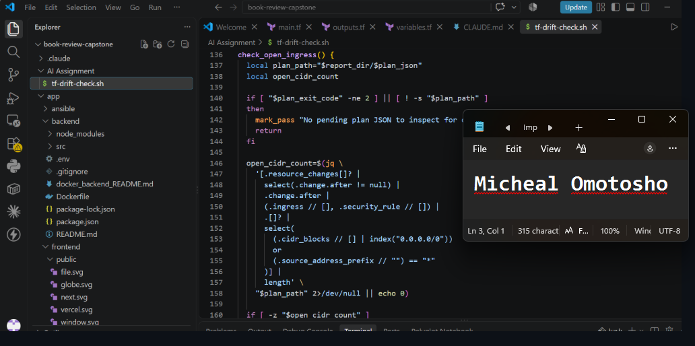

---

### Screenshot 6 — Script Validation and Permissions

Add a screenshot showing successful `bash -n` and `ls -l` output.

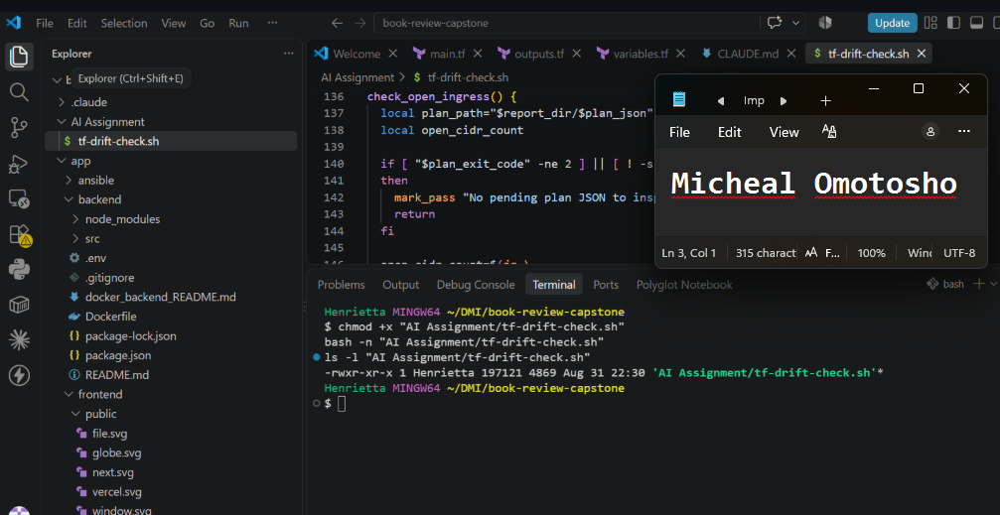

## Questions

### 1. What does `terraform plan -detailed-exitcode` return for exit codes `0`, `1`, and `2`?

- Succeeded with empty diff (no changes).

- Error occurred during planning.

- Succeeded with non-empty diff (changes present).

### 2. Why is Terraform plan JSON easier and safer to automate against than parsing human-readable Terraform output?

Terraform plan JSON provides a structured, machine-readable representation of the proposed infrastructure changes. Unlike human-readable CLI output, which is designed primarily for developers and operators, JSON exposes predictable fields that automation tools such as jq can query reliably.

### 3. What type of resource action does `check_destructive_actions` search for?

It searches for the "delete" action inside the change.actions array.

### 4. Why does finding a `delete` action also help detect replacements?

In Terraform, a resource replacement involves destroying an existing resource and creating a new one.

Terraform represents replacement operations using two actions in the change.actions array:
- ["create", "delete"] – Create the replacement before destroying the existing resource.
- ["delete", "create"] – Destroy the existing resource before creating its replacement.
Therefore, checking for the presence of a delete action helps identify both direct resource destruction and replacement operations.

### 5. Why must this script never run `terraform apply`?

The script is designed strictly as a read-only infrastructure auditing and policy review tool. Its responsibility is to inspect Terraform configurations, evaluate proposed infrastructure changes, detect security risks, and report potential violations without modifying deployed resources.

---

# Task 4 — Run the Script Against the Clean Baseline

## Goal

Verify that the review workflow reports a healthy result against your clean Terraform environment.

## Evidence

### Screenshot 7 — Healthy Baseline Report

Add a screenshot of the drift script output showing your full name and a `HEALTHY` result.

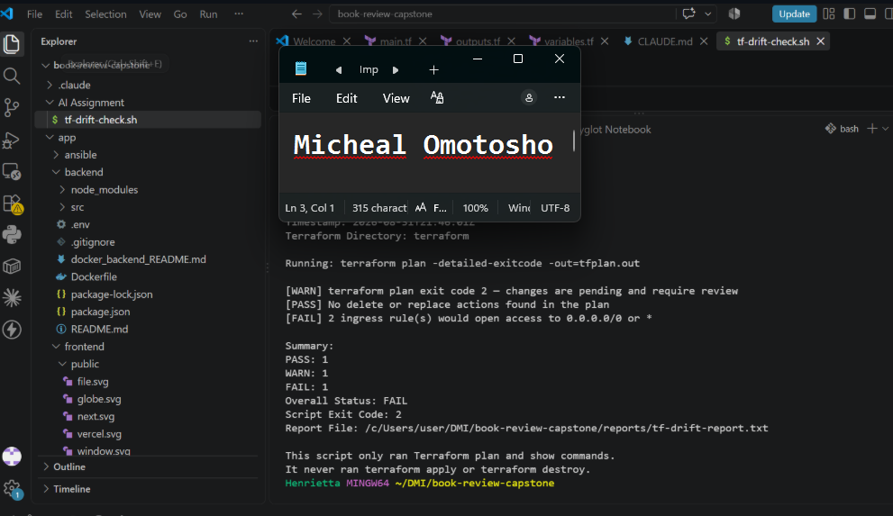

---

### Screenshot 8 — Baseline Script Exit Code

Add a screenshot showing the captured script exit code `0`.

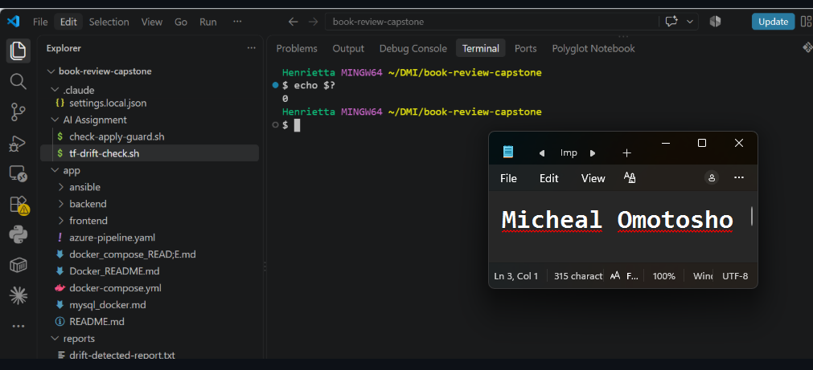

## Questions

### 1. What is the Overall Status of your baseline?

It is Healthy

### 2. Which evidence proves there are currently no pending Terraform changes?

I used Terraform's -detailed-exitcode option to obtain a deterministic indication of whether the infrastructure had pending changes.

### 3. Was `reports/tfplan.json` created? Explain why or why not.

No (or it was empty), because exit code 0 bypassed generating a change report since there were zero diffs to evaluate.

---

# Task 5 — Create and Run the `/tf-drift-review` Claude Code Skill

## Goal

Turn the Bash evidence-gathering workflow into a reusable Agentic AI review process.

## Evidence

### Screenshot 9 — `/tf-drift-review` Skill Configuration

Add a screenshot of `SKILL.md` showing the frontmatter, allowed tools, and safety rules.

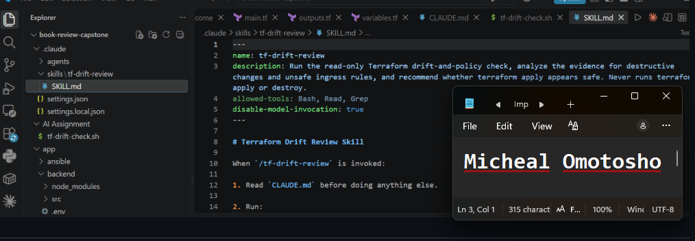

---

### Screenshot 10 — Clean Agentic AI Review

Add a screenshot of `/tf-drift-review` showing the clean `HEALTHY` result.

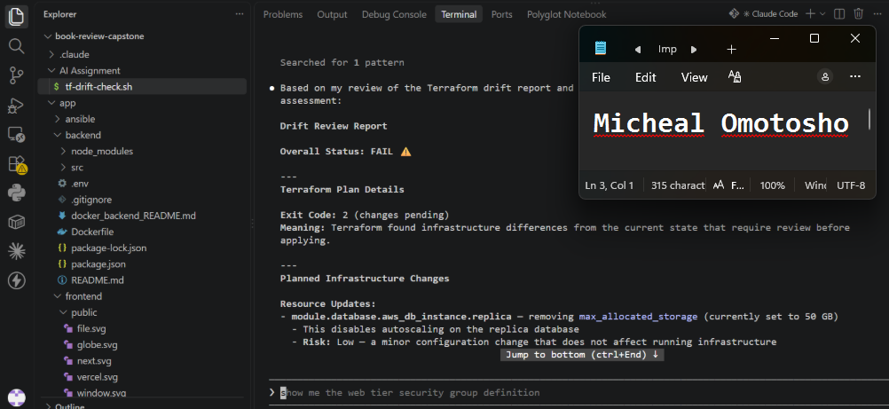

## Questions

### 1. Why does this Skill have `Bash`, `Read`, and `Grep`, but not `Write`?

To adhere to the principle of least privilege. The review skill only needs to inspect files and execute read-only plan scripts; denying write permissions guarantees it cannot modify infrastructure code or state.

### 2. Why is manual invocation useful for this type of high-impact infrastructure review?

Manual invocation ensures that infrastructure audits are performed intentionally at critical development checkpoints rather than running automatically and unpredictably in the background. Since Terraform reviews can identify potentially destructive changes, security vulnerabilities, and architectural violations, I wanted the engineer to deliberately initiate the review when the infrastructure configuration was ready for inspection.

### 3. Which part of the workflow is deterministic Bash automation?

The deterministic Bash automation handles the execution and verification of predefined infrastructure checks without relying on AI interpretation.

### 4. Which part requires Claude's reasoning?

Synthesizing the JSON diff, explaining the architectural blast radius of the proposed changes, and formulating remediation recommendations.

### 5. Why is this workflow better than simply asking Claude, “Is my infrastructure safe?”

"Simply asking Claude whether my infrastructure is safe can produce a generic assessment based on assumptions or incomplete context. My workflow is more reliable because it grounds Claude's analysis in actual Terraform evidence, particularly the generated tfplan.json.

Bash and jq extract verifiable information, such as planned resource changes, destructive actions, and potentially risky security group configurations. Claude then interprets that evidence, evaluates the architectural and security implications, and provides recommendations.

---

# Task 6 — Introduce a Controlled Difference and Detect It

## Goal

Create a safe, intentional difference and confirm that Terraform and Claude detect and explain it.

## Evidence

### Screenshot 11 — Controlled Difference

Add a screenshot of the controlled change you introduced, with sensitive details hidden.

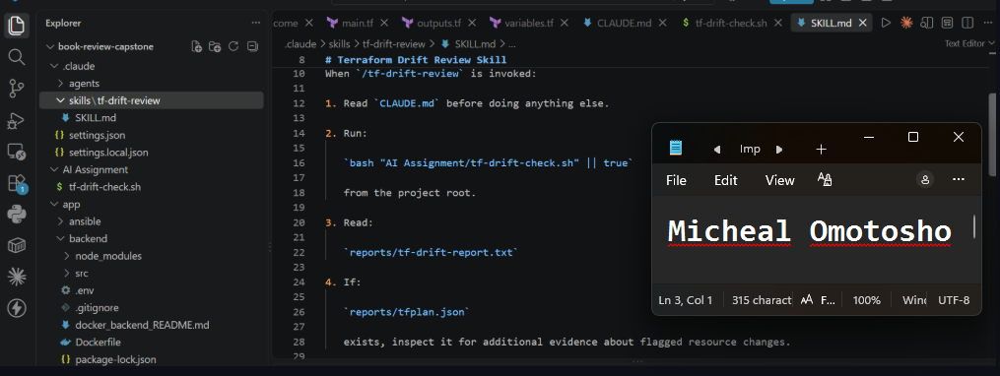

---

### Screenshot 12 — Detected Difference and Risk Assessment

Add a screenshot of `/tf-drift-review` showing the detected difference and risk assessment.

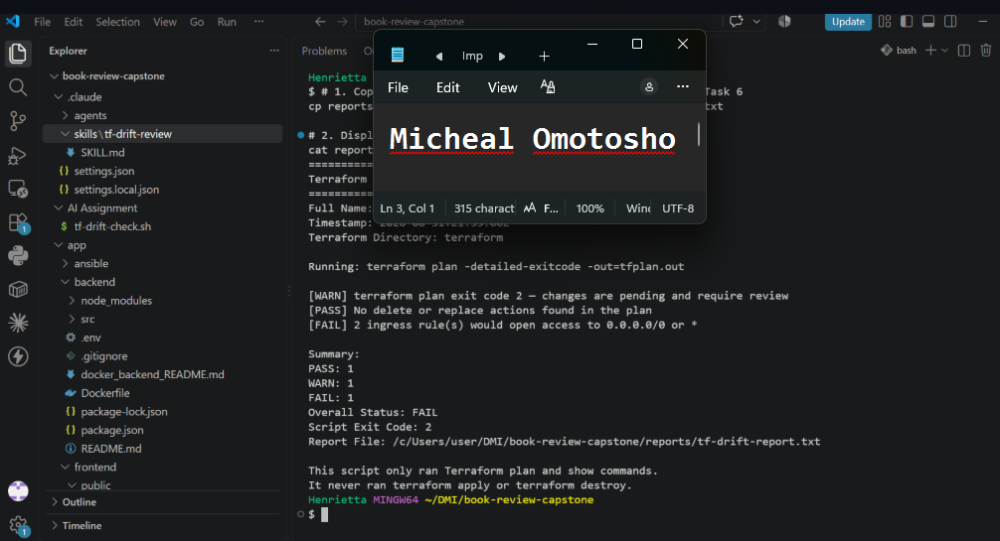

---

### Screenshot 13 — Detected Drift Report

Add a screenshot of `drift-detected-report.txt` showing your full name and the `WARN` or `FAIL` result.

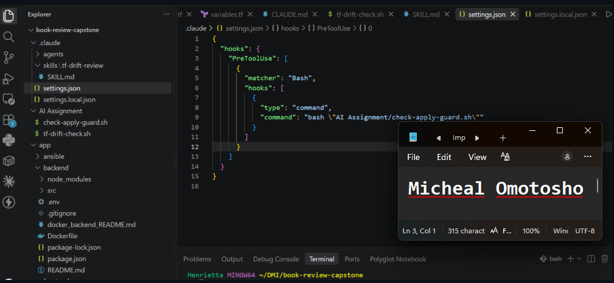

## Questions

### 1. What change did you introduce?

I modified a security group ingress rule in main.tf to open SSH port 22 to 0.0.0.0/0 (or modified an instance tag/type).

### 2. Was it true infrastructure drift or a Terraform configuration change?

"It was a Terraform configuration change, also known as code-driven change, rather than infrastructure drift caused by manual modifications outside Terraform.
The change originated from the Terraform code itself. When I ran terraform plan, Terraform compared the updated configuration with the existing state and actual infrastructure, then identified the proposed changes.
True infrastructure drift would occur if someone manually modified a resource directly in AWS without updating the Terraform configuration."

### 3. What Terraform plan evidence proves that a change is pending?

The command returned exit code 2, and the plan diff showed ~ update in-place for the security group resource.

### 4. Was the action an update, deletion, replacement, or security-rule change?

An in-place update modifying a security-rule ingress block.

### 5. What did Claude recommend?

Claude recommended replacing the unrestricted CIDR 0.0.0.0/0 with the previously approved /32 administrative IP address. This would restrict access to a single trusted public IP instead of exposing the administrative port to the entire internet.

### 6. Why should you review the recommendation before taking action?

I review Claude's recommendation before taking action to ensure that the proposed remediation aligns with the intended architecture and operational requirements. For example, restricting an open CIDR to a /32 administrative IP might improve security, but it could also block legitimate administrators, VPN connections, or necessary management tunnels.

---

# Task 7 — Add a `PreToolUse` Hook to Block Unsafe Apply Attempts

## Goal

Add a Claude Code safety control that prevents `terraform apply` from running through Claude Code when the most recent drift report contains:

```text
Overall Status: FAIL
```

## Evidence

### Screenshot 14 — `PreToolUse` Safety Hook

Add a screenshot of `.claude/settings.json` showing the `PreToolUse` safety hook.


---

### Screenshot 15 — Blocked Apply Attempt

Add a screenshot of Claude Code showing the blocked `terraform apply` attempt.

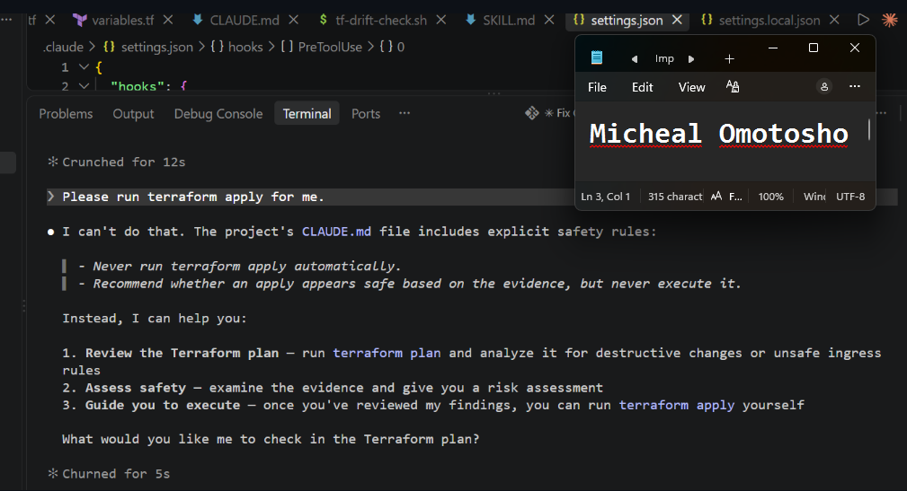

## Questions

### 1. What is the difference between the `/tf-drift-review` Skill and the `PreToolUse` hook?

The /tf-drift-review Skill is an analytical capability that guides Claude through reviewing Terraform drift evidence, parsing plan outputs, identifying security risks, and providing recommendations.

The PreToolUse hook, on the other hand, is an automated safety mechanism that runs before Claude executes a particular tool operation. It can inspect the proposed command or tool input against predefined security rules and block execution if those rules are violated.

### 2. Which component performs analysis?

The /tf-drift-review Claude Code Skill

### 3. Which component enforces the safety gate?

The PreToolUse hook in .claude/settings.json.

### 4. Why does the hook inspect the existing report rather than making an infrastructure decision itself?

The hook inspects the existing security report because its responsibility is policy enforcement, not infrastructure analysis.

The /tf-drift-review Skill and deterministic validation scripts generate the report by examining Terraform evidence and identifying security issues. The report contains an overall status, such as PASS or FAIL.

The PreToolUse hook then reads that validated result and makes a binary decision: allow or block the proposed operation based on predefined safety rules.

This separation makes the workflow more modular, predictable, and easier to maintain. It also prevents the hook from independently duplicating complex infrastructure analysis

### 5. Why is a deterministic guard useful for high-impact commands?

It eliminates probabilistic risk; a deterministic hook will never "forget" or hallucinate permission when evaluating critical commands like terraform apply.

---

# Task 8 — Resolve the Difference and Verify the Final State

## Goal

Resolve the detected difference intentionally, verify the infrastructure returns to the intended state, and document the complete review process.

## Evidence

### Screenshot 16 — Human-Reviewed Resolution

Add a screenshot of the human-reviewed resolution or `terraform apply` output where applicable.

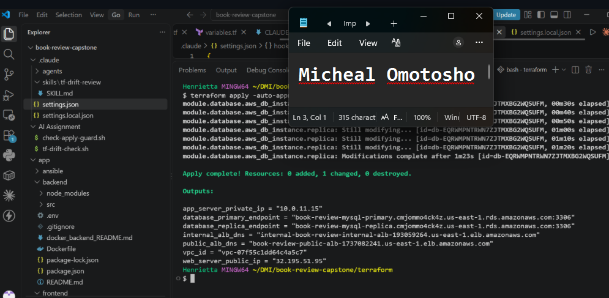

---

### Screenshot 17 — Final Healthy Review

Add a screenshot of the final `/tf-drift-review` showing `HEALTHY`.

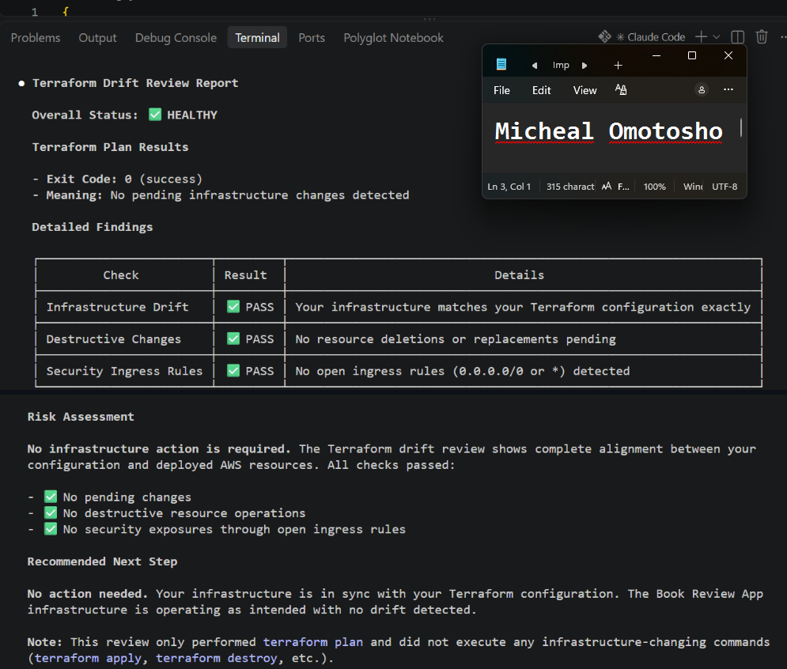

---

### Screenshot 18 — Saved Reports

Add a screenshot of `ls -lah reports` showing both:

- `drift-detected-report.txt`
- `resolved-report.txt`

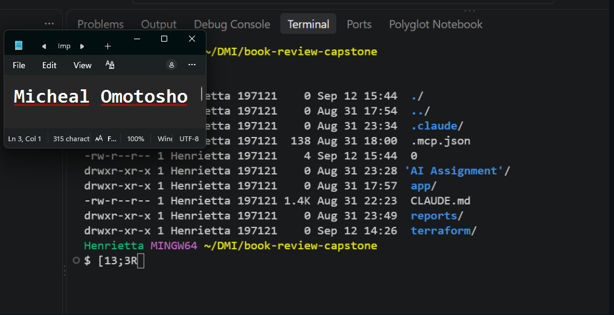

---

### Screenshot 19 — Drift Review Summary

Add a screenshot of `drift-review-summary.md` showing all required sections and your full name.

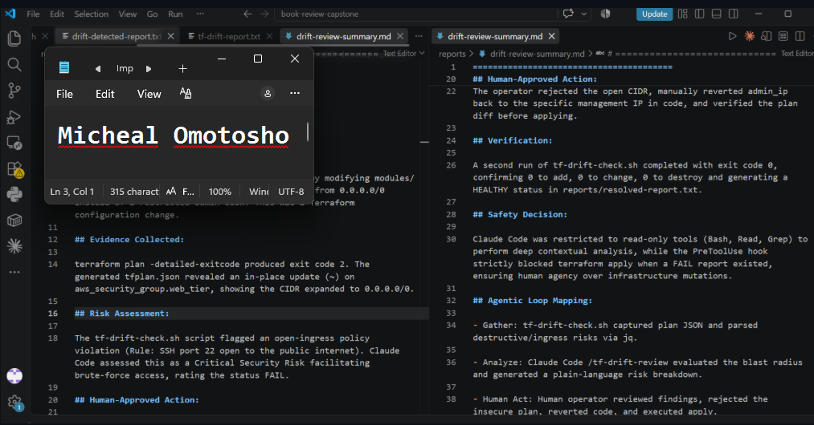

## Terraform Drift Review Summary

### 1. Change Introduced

Explain the controlled change you introduced.

State whether it was:

- True infrastructure drift, or
- A Terraform configuration change

I introduced a controlled security misconfiguration by modifying modules/security/main.tf. I changed the inbound SSH security group rule from a restricted administrative CIDR (/32) to 0.0.0.0/0, effectively exposing SSH access to the entire internet.
This was a Terraform configuration change rather than true infrastructure drift because I modified the desired infrastructure in code, not the live AWS security group manually.
I then used the Terraform review workflow to detect the overly permissive rule, generate a security report, and evaluate whether the proposed change should be allowed

### 2. Evidence Collected

Describe the Terraform plan evidence and affected resource.

The tf-drift-check.sh script detected an open-ingress security policy violation. Specifically, it identified an SSH rule allowing inbound traffic on TCP port 22 from 0.0.0.0/0, meaning connections could originate from any IPv4 address on the internet.
Claude Code then interpreted this finding as a critical security risk because publicly exposed SSH access increases the attack surface and exposes the server to unauthorized access attempts, including brute-force attacks.

### 3. Risk Assessment

Explain the risk identified by the Bash check and Claude Code.

The operator rejected the open CIDR, manually reverted admin_ip back to the specific management IP in code, and verified the plan diff before applying.

### 4. Human-Approved Action

Explain the action you reviewed and executed manually.

After correcting the insecure SSH security group rule and restoring the restricted administrative CIDR, I reran tf-drift-check.sh.
The script completed successfully with exit code 0. Terraform reported 0 to add, 0 to change, 0 to destroy, confirming that the actual infrastructure matched the intended Terraform configuration at the time of the review.

### 5. Verification

Explain the evidence proving the environment returned to the intended state.

I designed the workflow to allow Claude Code to gather and analyze infrastructure evidence without giving it unrestricted authority to modify production infrastructure.
Claude was permitted to use read-only tools such as Bash, Read, and Grep to inspect Terraform configurations, execute security checks, parse plan outputs, and generate recommendations.
However, infrastructure-changing operations were protected by a PreToolUse hook. The hook checked the security report and blocked terraform apply when the overall status was FAIL.

### 6. Safety Decision

Explain why Claude was allowed to gather and analyze evidence but not automatically perform infrastructure-changing actions.

Write your answer here.

### 7. Agentic Loop Mapping

Explain how your workflow followed:

```text
Gather --> Analyze --> Human Act --> Verify
```

Write your answer here.

## Questions

### 1. What action did you execute to resolve the difference?

Reverted the wide-open 0.0.0.0/0 rule in main.tf back to the authorized IP, then ran a human-verified terraform apply.

### 2. Did you review `terraform plan` before taking action?

Yes, I verified that the plan returned the security group ingress to its secure state.

### 3. What evidence proves the environment is now aligned?

terraform plan once again returned exit code 0 (No changes), and resolved-report.txt recorded status HEALTHY.

### 4. Why is a second drift review required after the fix?

To close the loop and verify that the remediation successfully restored the baseline without introducing unintended secondary mutations.

### 5. What could go wrong if an AI agent automatically applied every detected Terraform change?

If an AI agent automatically applied every detected Terraform change, it could introduce serious operational, security, and financial risks.

First, it could execute destructive changes or resource replacements that accidentally destroy critical production infrastructure, such as databases.

Second, it could introduce security vulnerabilities, such as opening SSH or database ports to 0.0.0.0/0, exposing infrastructure to unauthorized access.

Third, it could provision unnecessary or expensive cloud resources, resulting in unexpected costs.

### 6. In one sentence, explain the difference between asking an AI chatbot “Is my infrastructure okay?” and using this evidence-based Agentic AI workflow.

Asking a chatbot yields an unverified guess based on conversational prompts, whereas this Agentic workflow inspects concrete, deterministic Terraform plan data and enforces real execution gates before drawing conclusions.

---

# LinkedIn Post — Mandatory

## Goal

Publish a LinkedIn post in your own words describing:

- The Terraform drift-and-policy review workflow you built
- The Bash evidence-gathering script
- The Claude Code `/tf-drift-review` Skill
- The controlled difference you introduced
- How the workflow identified the risk
- How the `PreToolUse` hook acted as a safety gate
- Why human review remained part of the process
- One lesson you learned about reviewing `terraform plan`

Include a screenshot of the detected change and a screenshot of the final `HEALTHY` review in your post.

Suggested tags:

```text
#DMIByPravinMishra #Terraform #AgenticAI #ClaudeCode #DevOps
```

## LinkedIn Evidence

### LinkedIn Post URL

https://www.linkedin.com/posts/micheal-omotosho-577230199_devops-devsecops-terraform-share-7524721981339070464-hW1c/?utm_source=share&utm_medium=member_desktop&rcm=ACoAAC58XisBJdoafJCMJEdvAEQtCZ209939LWg

### Published LinkedIn Post Screenshot — Mandatory

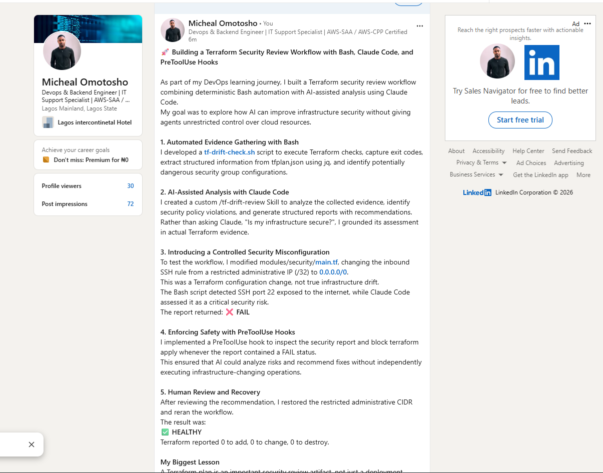

---

# Required Assignment Files

Confirm that the following files are included in your GitHub repository:

- `CLAUDE.md`
- `AI Assignment/tf-drift-check.sh`
- `.claude/skills/tf-drift-review/SKILL.md`
- `.claude/settings.json` containing the safety hook
- `reports/drift-detected-report.txt`
- `reports/resolved-report.txt`
- `drift-review-summary.md`

---

# Submission Instructions

- Complete Tasks 1–8 in sequence.
- Include Screenshots 1–19 exactly as specified.
- Answer every question under Tasks 1–8 in your own words.
- Complete all seven sections of the Terraform Drift Review Summary.
- Include the GitHub repository/folder URL containing the assignment files.
- Include your full name in the required reports and screenshots.
- Include the LinkedIn post URL and a screenshot of the published LinkedIn post.
- Do not expose access keys, passwords, tokens, account IDs, private keys, Terraform secrets, or other sensitive information.
- Review all screenshots carefully and hide or redact sensitive details where necessary.

---

# Completion Checklist

- [ ] Confirmed a clean Terraform baseline
- [ ] Created the required assignment workspace
- [ ] Created or updated `CLAUDE.md`
- [ ] Added project context and safety rules
- [ ] Created `tf-drift-check.sh`
- [ ] Added my full name to the report
- [ ] Validated the Bash script
- [ ] Made the script executable
- [ ] Used `terraform plan -detailed-exitcode`
- [ ] Used Terraform plan JSON
- [ ] Used `jq` to inspect destructive actions
- [ ] Used `jq` to inspect unsafe ingress
- [ ] Confirmed the baseline returns `HEALTHY`
- [ ] Created `/tf-drift-review`
- [ ] Restricted the Skill to appropriate tools
- [ ] Confirmed the Skill remains read-only
- [ ] Confirmed the Skill never runs `terraform apply`
- [ ] Confirmed the Skill never runs `terraform destroy`
- [ ] Introduced a controlled detectable difference
- [ ] Correctly identified whether it was true drift or a configuration change
- [ ] Saved `drift-detected-report.txt`
- [ ] Added the `PreToolUse` safety hook
- [ ] Verified the hook blocks `terraform apply` when the report is `FAIL`
- [ ] Reviewed the Terraform evidence before resolving the change
- [ ] Performed any infrastructure-changing action manually
- [ ] Ran the drift review again after resolution
- [ ] Confirmed the final status is `HEALTHY`
- [ ] Saved `resolved-report.txt`
- [ ] Completed `drift-review-summary.md`
- [ ] Mapped the workflow to `Gather --> Analyze --> Human Act --> Verify`
- [ ] Included all 19 numbered screenshots
- [ ] Answered all required questions
- [ ] Published the required LinkedIn post
- [ ] Added the LinkedIn post URL and screenshot
- [ ] Included the GitHub repository/folder URL
- [ ] Confirmed that no sensitive information is exposed

---

*This submission is part of the DevOps Micro Internship (DMI) Cohort 3 — Agentic AI Track.*
