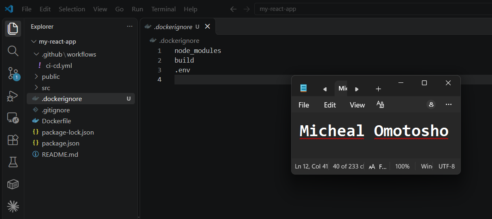
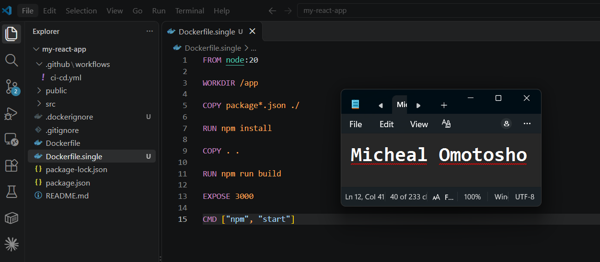
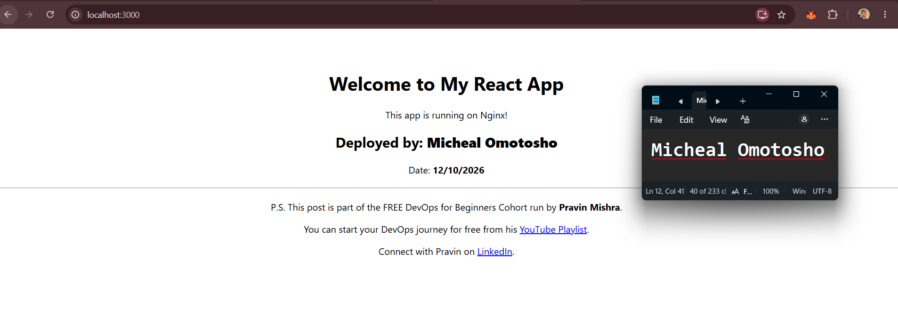
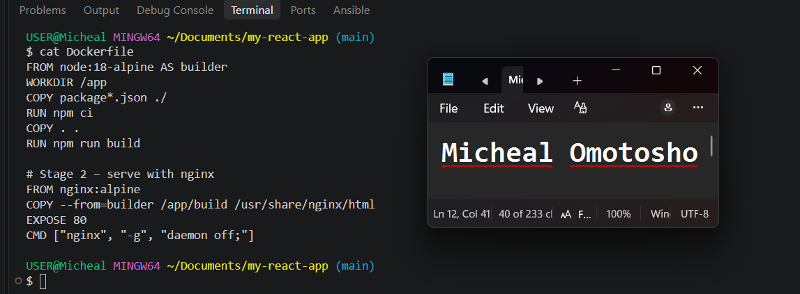
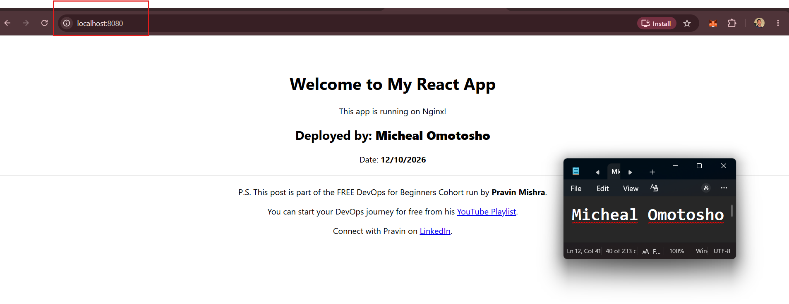
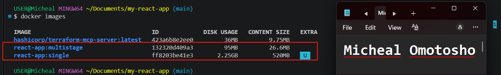
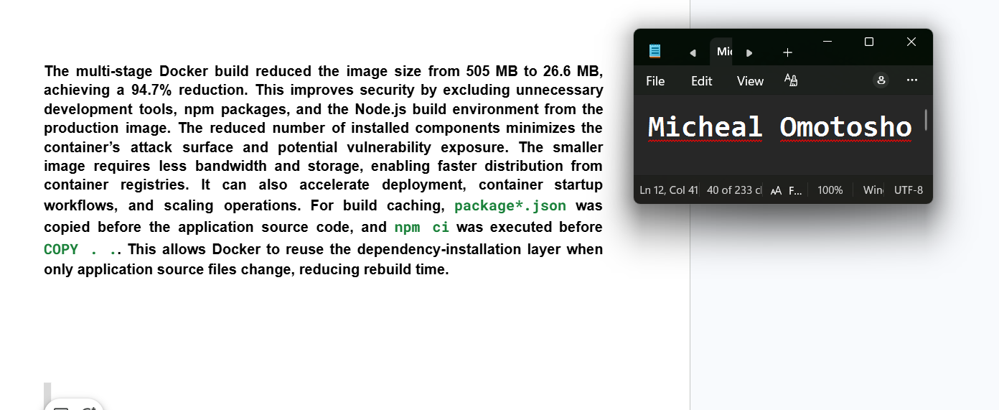
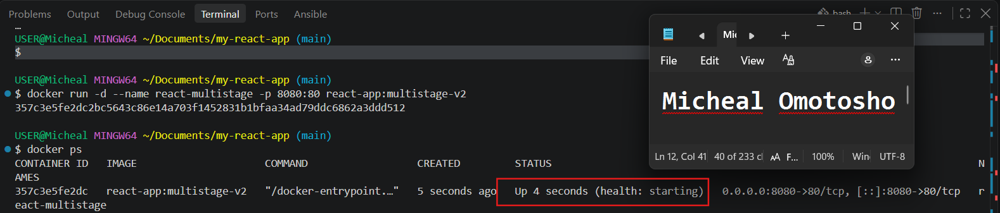

# Assignment 2 — Multi-Stage Docker Build for a React Application

Part of the DevOps Micro Internship (DMI) Cohort 3 with Agentic AI

---

## Purpose

In this assignment, you will build both a single-stage and an optimized multi-stage Docker image for a React application, compare the resulting image sizes, and deploy the optimized version using a production-ready Nginx runtime container.

---

# Task 1 — Prepare the Project

## Goal

Clone `https://github.com/pravinmishraaws/my-react-app.git` and create a `.dockerignore` excluding `node_modules`, `build`, and `.env`.

### Evidence

#### Screenshot 1 — Contents of the `.dockerignore` file

---

# Task 2 — Create a Single-Stage Docker Image

## Goal

Create `Dockerfile.single`, build `react-single`, and run it on port 3000.

### Evidence

#### Screenshot 2 — Contents of `Dockerfile.single`

---

#### Screenshot 3 — Browser displaying the application running from the single-stage container

---

# Task 3 — Create a Multi-Stage Docker Build

## Goal

Create a multi-stage Dockerfile with separate build and Nginx runtime stages, build `react-multistage`, and run it on port 80.

### Evidence

#### Screenshot 4 — Contents of the multi-stage Dockerfile

---

#### Screenshot 5 — Browser displaying the application running from the multi-stage container

---

# Task 4 — Compare Docker Image Sizes

## Goal

Compare the single-stage and multi-stage image sizes and calculate the percentage reduction.

### Evidence

#### Screenshot 6 — Docker image list showing both image sizes

---

# Task 5 — Analyze the Optimization Results

## Goal

Write a 5–8 line analysis covering the percentage reduction, security benefits, reduced attack surface, faster distribution, and one build-caching optimization used.

### Evidence

#### Screenshot 7 — Analysis included in your submission document

---

### Notes

Write your analysis here.

The multi-stage Docker build reduced the image size from 505 MB to 26.6 MB, achieving a 94.7% reduction.
This improves security by excluding unnecessary development tools, npm packages, and the Node.js build environment from the production image.
The reduced number of installed components minimizes the container’s attack surface and potential vulnerability exposure.
The smaller image requires less bandwidth and storage, enabling faster distribution from container registries.
It can also accelerate deployment, container startup workflows, and scaling operations.
For build caching, package*.json was copied before the application source code, and npm ci was executed before COPY . ..
This allows Docker to reuse the dependency-installation layer when only application source files change, reducing rebuild time.

---

# Task 6 — Explore Additional Production Optimizations (Optional)

## Goal

Optionally configure an Nginx health check, cache headers, parameterized ports via environment variables, or a lighter runtime image, and compare results.

---

# LinkedIn Post (Optional)

## Goal

Create a LinkedIn post describing what you built, what a multi-stage Docker build is, the image size reduction achieved, and key learnings.

## Evidence

#### LinkedIn Post URL

Paste your LinkedIn post URL here:

https://www.linkedin.com/posts/micheal-omotosho-577230199_docker-devops-containerization-ugcPost-7515595709090357248-vIwE/?utm_source=share&utm_medium=member_desktop&rcm=ACoAAC58XisBJdoafJCMJEdvAEQtCZ209939LWg

---

#### Screenshot — Published LinkedIn post

---

# Submission Instructions

- Add all required screenshots in your submission
- Full name must be visible in required screenshots
- Do not expose sensitive information

---

# Completion Checklist

- [ ] Task 1: `.dockerignore` created (Screenshot 1)
- [ ] Task 2: Single-stage image built and verified (Screenshots 2–3)
- [ ] Task 3: Multi-stage image built and verified (Screenshots 4–5)
- [ ] Task 4: Image sizes compared (Screenshot 6)
- [ ] Task 5: Analysis written (Screenshot 7 & Notes)
- [ ] Task 6: Optional production optimizations explored
- [ ] No sensitive information exposed

---

## 📌 About DMI & CloudAdvisory

DevOps Micro Internship (DMI) is a project-based DevOps program run by Pravin Mishra (The CloudAdvisory) focused on real-world execution, systems thinking, and career readiness.

It helps learners build strong DevOps foundations with hands-on experience.

---

## 📌 Resources

- 🌐 DMI Official Website: https://dmi.pravinmishra.com?utm_source=github&utm_medium=readme  
- 🎓 University: https://university.pravinmishra.com?utm_source=github&utm_medium=readme  
- 💬 Discord Community: https://discord.pravinmishra.com?utm_source=github&utm_medium=readme  
- 📝 Blog: https://dmi.pravinmishra.com/blog?utm_source=github&utm_medium=readme  
- ▶️ YouTube Playlist: https://www.youtube.com/playlist?list=PLFeSNDtI4Cho  
- 🔗 Pravin Mishra (LinkedIn): https://www.linkedin.com/in/pravin-mishra-aws-trainer/  
- 🏢 CloudAdvisory (LinkedIn): https://www.linkedin.com/company/thecloudadvisory/

---

*This submission is part of DevOps Micro Internship (DMI) Cohort 3 — Agentic AI Track.*
