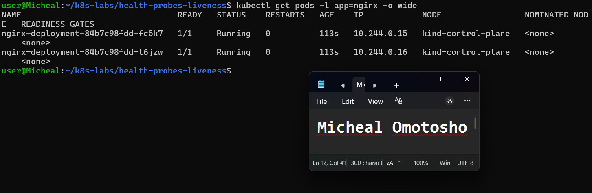
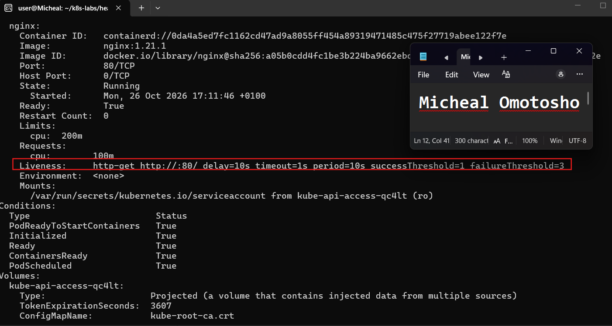
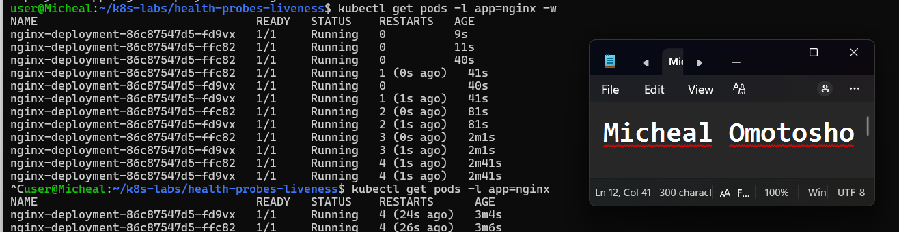
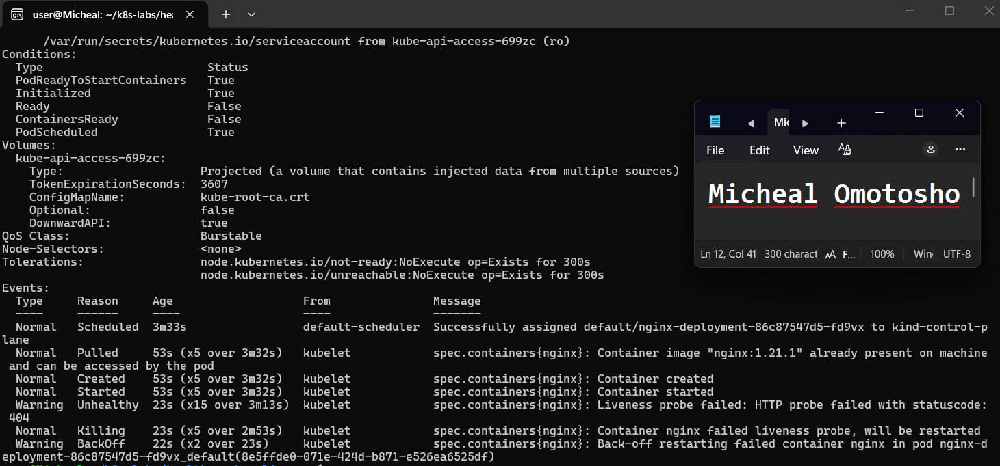
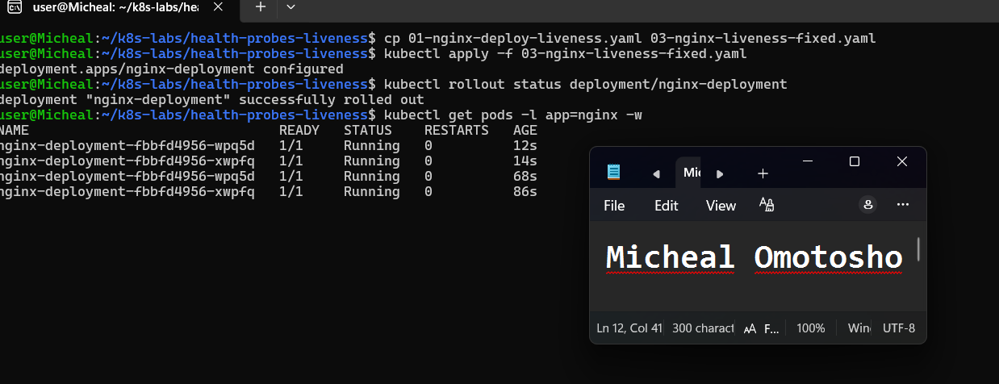

# Assignment 6 — Kubernetes Health Probes (Liveness)

Part of the DevOps Micro Internship (DMI) Cohort 3 with Agentic AI

---

## Purpose

In this guided lab, you will add an HTTP liveness probe to NGINX, force repeated failures, observe container restarts, restore the healthy probe, and review safe tuning.

---

# Task 1 — Create the Baseline Deployment

## Goal

Deploy two NGINX Pods without probes (`00-nginx-deploy-baseline.yaml`).

### Evidence

#### Screenshot 1 — Baseline Deployment and two running Pods

---

# Task 2 — Add the Liveness Probe

## Goal

Add an HTTP liveness probe on `/` port 80 (`01-nginx-deploy-liveness.yaml`) and confirm the kubelet checks it every 10 seconds after the initial delay.

### Evidence

#### Screenshot 2 — Pod description showing the liveness probe

---

# Task 3 — Trigger and Observe a Liveness Restart

## Goal

Change the liveness path to `/does-not-exist`, apply it, and watch `RESTARTS` increase over roughly 20 seconds.

### Evidence

#### Screenshot 3 — Pod RESTARTS increment and the corresponding liveness failure events

---

# Task 4 — Restore and Stabilize the Probe

## Goal

Reapply the good liveness manifest and confirm restart counts stop increasing.

### Evidence

#### Screenshot 4 — Stable Pod state after the fixed manifest is applied

---

# Task 5 — Review Tuning, Troubleshooting, and Cleanup

## Goal

Review recommended probe ranges and retain or delete the Deployment.

### Evidence

#### Screenshot 5 — Final healthy state and any troubleshooting evidence used

---

### Notes

Write a short note describing what the lab demonstrated.

The lab demonstrated the Kubernetes Liveness Probe feature by implementing a working liveness probe and then deliberately breaking it to observe the pod's behavior. I monitored how Kubernetes repeatedly restarted the pod, with the restart count increasing each time the probe failed. This lab helped me understand how liveness probes detect unhealthy applications and trigger automatic restarts to restore their functionality. It also demonstrated that applications can become unhealthy even after running successfully for an extended period.

---

# Submission Instructions

- Add all required screenshots in your submission
- Include the completed YAML manifests used in the lab

---

# Completion Checklist

- [ ] Task 1: Baseline Deployment applied (Screenshot 1)
- [ ] Task 2: Liveness probe added and verified (Screenshot 2)
- [ ] Task 3: Liveness restart triggered and observed (Screenshot 3)
- [ ] Task 4: Probe restored and stabilized (Screenshot 4)
- [ ] Task 5: Tuning reviewed / cleanup completed (Screenshot 5)
- [ ] Reflection notes written (Notes)

---

## 📌 About DMI & CloudAdvisory

DevOps Micro Internship (DMI) is a project-based DevOps program run by Pravin Mishra (The CloudAdvisory) focused on real-world execution, systems thinking, and career readiness.

It helps learners build strong DevOps foundations with hands-on experience.

---

## 📌 Resources

- 🌐 DMI Official Website: https://dmi.pravinmishra.com?utm_source=github&utm_medium=readme  
- 🎓 University: https://university.pravinmishra.com?utm_source=github&utm_medium=readme  
- 💬 Discord Community: https://discord.pravinmishra.com?utm_source=github&utm_medium=readme  
- 📝 Blog: https://dmi.pravinmishra.com/blog?utm_source=github&utm_medium=readme  
- ▶️ YouTube Playlist: https://www.youtube.com/playlist?list=PLFeSNDtI4Cho  
- 🔗 Pravin Mishra (LinkedIn): https://www.linkedin.com/in/pravin-mishra-aws-trainer/  
- 🏢 CloudAdvisory (LinkedIn): https://www.linkedin.com/company/thecloudadvisory/

---

*This submission is part of DevOps Micro Internship (DMI) Cohort 3 — Agentic AI Track.*
