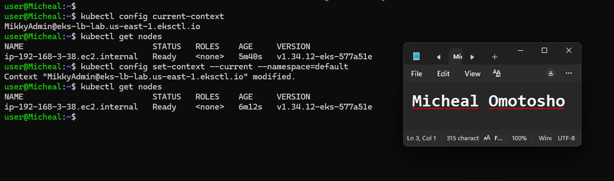
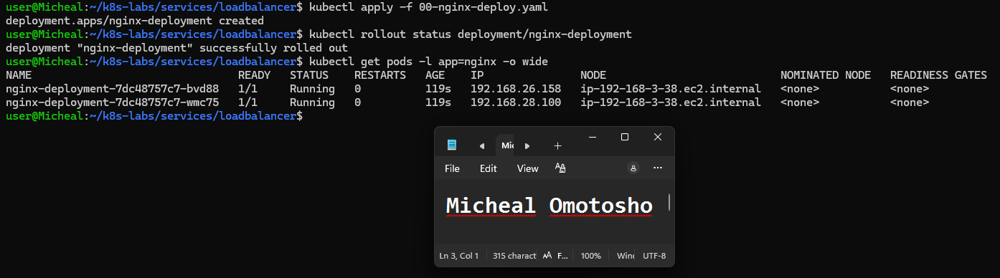
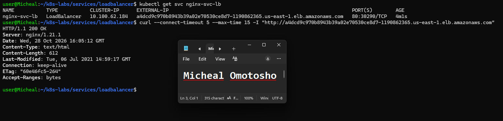
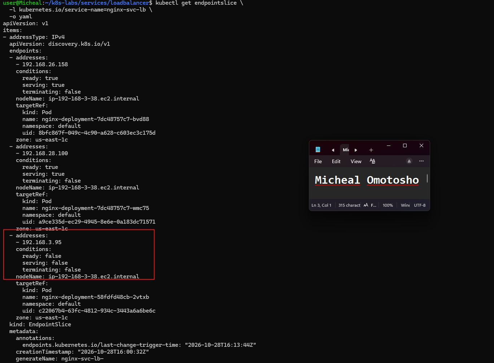
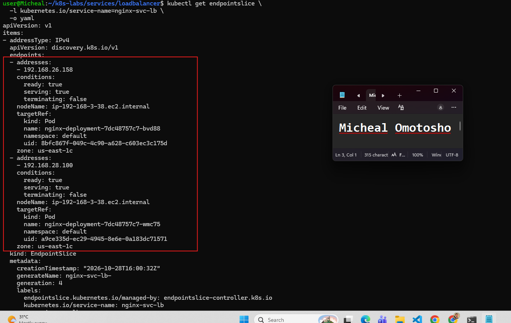
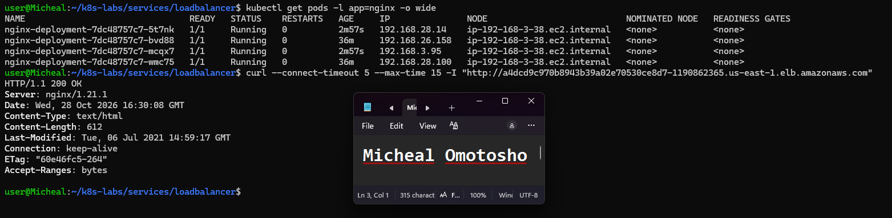

# Assignment 9 — Kubernetes Services (LoadBalancer)

Part of the DevOps Micro Internship (DMI) Cohort 3 with Agentic AI

---

## Purpose

In this guided lab, you will provision a small AKS cluster, deploy probed NGINX Pods, expose them with a public LoadBalancer Service, test the internet endpoint, and observe readiness and scaling.

---

# Task 1 — Provision and Connect to AKS

## Goal

Create resource group `rg-aks-lb-lab` and a one-node AKS cluster `aks-lb-lab` (`westeurope`, `Standard_B2s`), then fetch credentials and verify the node.

### Evidence

#### Screenshot 1 — AKS creation result and Ready node output

---

# Task 2 — Deploy the Probed NGINX Workload

## Goal

Create two healthy, probed NGINX Pods for the public Service.

### Evidence

#### Screenshot 2 — Successful rollout and two Ready Pods

---

# Task 3 — Create and Test the LoadBalancer Service

## Goal

Create `nginx-svc-lb` (type `LoadBalancer`, port 80), wait for `EXTERNAL-IP`, and test it with `curl`.

### Evidence

#### Screenshot 3 — Service with public `EXTERNAL-IP` and successful `curl` output

---

# Task 4 — Prove Readiness Affects Public Traffic

## Goal

Apply a broken readiness patch, confirm the Pod leaves the endpoint set and public availability is affected, then restore health.

### Evidence

#### Screenshot 4 — Endpoint changes and public `curl` behavior before and after recovery

---

# Task 5 — Scale Behind the Stable Public Endpoint

## Goal

Scale to four replicas and confirm the endpoint set grows while the public IP stays the same.

### Evidence

#### Screenshot 5 — Four replicas/endpoints behind the unchanged public endpoint

---

# Task 6 — Troubleshoot and Clean Up

## Goal

Resolve any pending endpoint or unhealthy backend issues, then delete the Kubernetes objects and Azure resource group when finished.

### Evidence

#### Screenshot 6 — Clean final verification or resource deletion command output

Add your screenshot here.

---

### Notes

Write a short note describing what the lab demonstrated.

The lab demonstrated the implementation of a Kubernetes LoadBalancer Service using an AWS EKS cluster. I deployed two Nginx pods with rolling update, liveness probe, and readiness probe configurations, then created a separate LoadBalancer Service with a selector targeting the Nginx pods. AWS provisioned an external public IP address, which I tested using a `curl` command from my laptop to verify external access to the application. I also intentionally introduced a readiness probe error to observe how Kubernetes handled pod readiness and service endpoints. This lab helped me understand how Kubernetes LoadBalancer Services expose applications externally and how readiness probes influence traffic routing to pods.

---

# Submission Instructions

- Add all required screenshots in your submission
- Include the completed YAML manifests used in the lab

---

# Completion Checklist

- [ ] Task 1: AKS cluster provisioned and connected (Screenshot 1)
- [ ] Task 2: Probed NGINX Deployment applied (Screenshot 2)
- [ ] Task 3: LoadBalancer Service created and tested (Screenshot 3)
- [ ] Task 4: Readiness impact on public traffic proven (Screenshot 4)
- [ ] Task 5: Scaled behind the stable endpoint (Screenshot 5)
- [ ] Task 6: Verified / cleaned up Azure resources (Screenshot 6)
- [ ] Reflection notes written (Notes)

---

## 📌 About DMI & CloudAdvisory

DevOps Micro Internship (DMI) is a project-based DevOps program run by Pravin Mishra (The CloudAdvisory) focused on real-world execution, systems thinking, and career readiness.

It helps learners build strong DevOps foundations with hands-on experience.

---

## 📌 Resources

- 🌐 DMI Official Website: https://dmi.pravinmishra.com?utm_source=github&utm_medium=readme  
- 🎓 University: https://university.pravinmishra.com?utm_source=github&utm_medium=readme  
- 💬 Discord Community: https://discord.pravinmishra.com?utm_source=github&utm_medium=readme  
- 📝 Blog: https://dmi.pravinmishra.com/blog?utm_source=github&utm_medium=readme  
- ▶️ YouTube Playlist: https://www.youtube.com/playlist?list=PLFeSNDtI4Cho  
- 🔗 Pravin Mishra (LinkedIn): https://www.linkedin.com/in/pravin-mishra-aws-trainer/  
- 🏢 CloudAdvisory (LinkedIn): https://www.linkedin.com/company/thecloudadvisory/

---

*This submission is part of DevOps Micro Internship (DMI) Cohort 3 — Agentic AI Track.*
